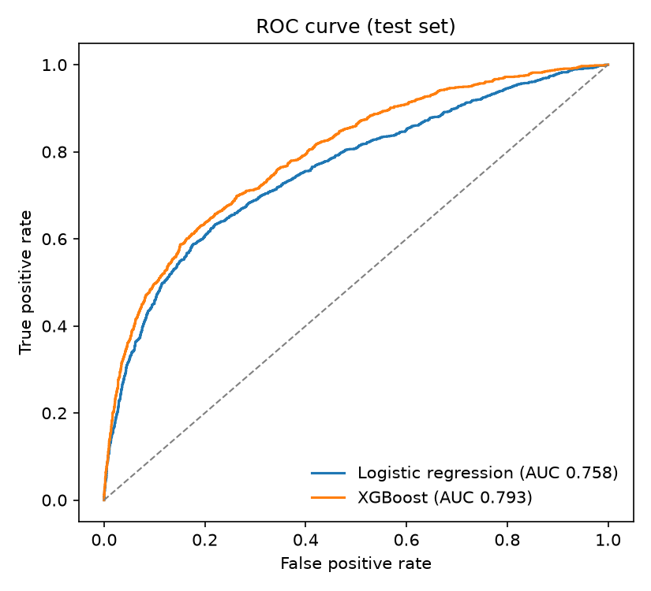
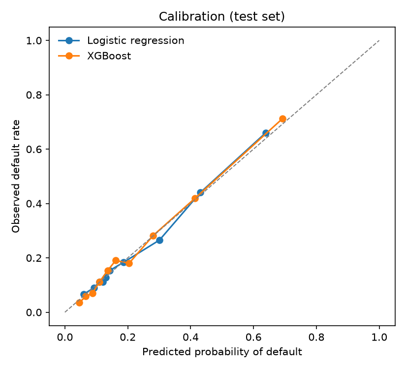
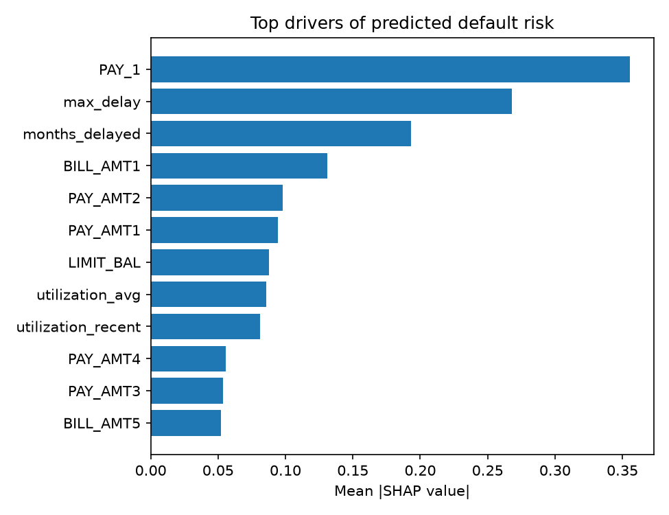

# Credit Risk Scoring API


An explainable machine learning model that predicts whether a credit card client will default,
served as a production-style REST API with FastAPI and Docker.

Every prediction comes with a **risk band**, a **decision** (approve / manual review / decline)
and the **top reasons** behind it, so a credit analyst can understand and challenge the result.
The project also reports **fairness** across sex and age groups and documents the model against
**EU AI Act** requirements for high-risk credit scoring.

## Why this project

Credit scoring is one of the most regulated uses of machine learning in Europe. A good model is
not enough: it has to be explainable, fair, monitored and easy to integrate. This repository
shows the full lifecycle, from raw data to a tested, containerised API.

## Results

Held-out test set (20% of clients, never seen during training; overall default rate 22.1%):

| Model | AUC | Gini | KS | Brier ↓ |
|---|---|---|---|---|
| Logistic regression (baseline) | 0.758 | 0.515 | 0.413 | 0.140 |
| **XGBoost** | **0.793** | **0.586** | **0.439** | **0.133** |

At the cost-optimal threshold (0.135), the model catches **85% of defaulters** and lowers expected
cost per client from 1.11 (approve everyone) to **0.53**, a reduction of about 52%.

<p>
  
  
  
</p>

**Key findings**

- XGBoost improves Gini by **7 points** over logistic regression, the traditional scorecard
  approach, and is also better calibrated (lower Brier score).
- **Recent repayment behaviour dominates:** the repayment status of the latest month, the worst
  delay and the number of late months are the strongest drivers of default risk.
- The threshold reflects an assumed 5:1 cost of a missed defaulter vs a declined good client, so
  the model flags about 56% of clients for decline or review. This is one setting in `config.py`
  and would be calibrated to a lender's actual loss data and risk appetite.
- Fairness by sex and age band is reported in `reports/metrics.json` and discussed in the
  [model card](MODEL_CARD.md).

## Architecture

```
UCI dataset ──► data.py ──► features.py ──► train.py ──► models/model.joblib
 (download)     (clean)    (engineering)   (LR vs XGBoost,          │
                                            threshold, fairness)    ▼
                                                              api.py (FastAPI)
                                                    POST /score  ·  /score/batch  ·  GET /health
```

## Approach

1. **Data:** 30,000 credit card clients from the UCI *Default of Credit Card Clients* dataset.
   Undocumented category codes are cleaned.
2. **Features:** credit utilisation, repayment ratio, number of late months, worst delay and
   balance trend, engineered from six months of history. Sex and marital status are excluded
   from the model and used only for fairness monitoring.
3. **Models:** logistic regression baseline vs XGBoost with early stopping on a validation set.
4. **Decision threshold:** chosen on validation data to minimise expected cost, assuming a missed
   defaulter costs 5× a wrongly declined client.
5. **Evaluation:** AUC, Gini, KS, Brier score and calibration on an untouched test set.
6. **Explainability:** per-prediction SHAP values turned into plain-language reason codes.
7. **Fairness:** approval and error rates by sex and age band.
8. **Serving:** FastAPI with input validation, Docker image, and CI that lints, tests on three
   Python versions and smoke-tests the container.

## Quick start

```bash
git clone https://github.com/Pooja-Adhav/credit-risk-scoring-api.git
cd credit-risk-scoring-api
python -m venv .venv
source .venv/bin/activate          # Windows: .venv\Scripts\activate
pip install -e ".[dev]"

python -m credit_risk.data         # download the dataset
python -m credit_risk.train        # train, evaluate, save model and reports
uvicorn credit_risk.api:app
```

Open http://127.0.0.1:8000/docs to try the API in your browser.

### Example request

```bash
curl -X POST http://127.0.0.1:8000/score -H "Content-Type: application/json" -d '{
  "limit_bal": 50000, "education": 2, "age": 35,
  "repayment_status": [2, 2, 0, 0, 0, 0],
  "bill_amounts": [48000, 47000, 45000, 40000, 38000, 30000],
  "payment_amounts": [0, 1500, 2000, 1500, 1500, 2000]
}'
```

```json
{
  "probability_of_default": 0.6147,
  "risk_band": "E",
  "decision": "decline",
  "top_risk_drivers": [
    {"feature": "PAY_1", "description": "repayment status 1 month(s) ago", "impact": 1.1339},
    {"feature": "max_delay", "description": "longest payment delay", "impact": 0.3887},
    {"feature": "months_delayed", "description": "number of months with late payments", "impact": 0.1247}
  ],
  "model_version": "1.0.0"
}
```
A client who was two months late on the latest payment gets a 61% probability of default,
band E, and a decline, driven mainly by that recent delay.

### Docker

```bash
python -m credit_risk.train        # the image packages the trained model
docker build -t credit-risk-api .
docker run -p 8000:8000 credit-risk-api
```

### Tests

```bash
pytest          # 21 tests: features, model, metrics, API and input validation
ruff check .    # linting
```

Tests use a synthetic dataset with the same schema, so they run offline and in CI.

## Project structure

```
├── src/credit_risk/
│   ├── config.py       # paths, columns, cost assumptions, risk bands
│   ├── data.py         # download, cleaning, synthetic data for tests
│   ├── features.py     # feature engineering shared by training and API
│   ├── train.py        # baseline vs XGBoost, threshold, fairness, reports
│   ├── evaluate.py     # AUC, Gini, KS, calibration, fairness, plots
│   ├── predict.py      # scoring with SHAP reason codes
│   └── api.py          # FastAPI service
├── tests/              # pytest suite
├── reports/            # metrics.json and figures (generated)
├── MODEL_CARD.md       # intended use, fairness, EU AI Act context, limitations
├── Dockerfile
└── .github/workflows/ci.yml
```

## Responsible AI

See [MODEL_CARD.md](MODEL_CARD.md) for intended use, fairness results, limitations and how the
project relates to the EU AI Act (credit scoring is a high-risk use case) and GDPR Art. 22.

## Roadmap

- [ ] Experiment tracking with MLflow
- [ ] Data drift monitoring (Population Stability Index per feature)
- [ ] Probability calibration (isotonic) and comparison
- [ ] Deployment to Azure Container Apps

## Data and license

Data: Yeh, I-C. (2009), *Default of Credit Card Clients*, UCI Machine Learning Repository
(CC BY 4.0). Code: MIT License.

---
**Author:** Pooja Adhav · [LinkedIn](https://www.linkedin.com/in/pooja-adhav-682744188/)
